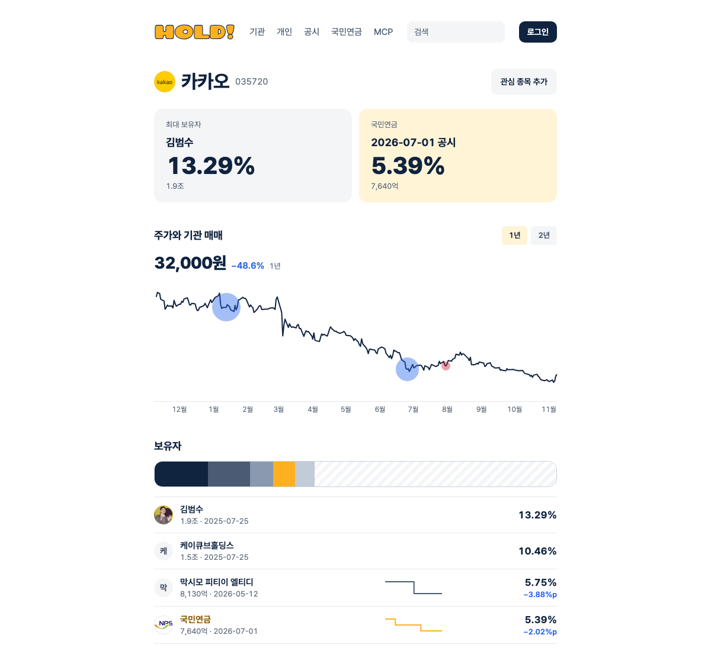

# HOLD! MCP — 한국 상장사를 누가 들고 있나

[English](README.md)

AI에게 "이 회사 누가 들고 있어?", "이번 주 국민연금이 판 종목", "최대주주가 얼마에 샀어?"를 물어보세요. HOLD!는 금융감독원 전자공시(DART)의 지분 공시를 정리해 원격 MCP 서버로 제공해요.

```
https://whohold.com/mcp
```

설치할 프로그램도, API 키도 없어요. Streamable HTTP를 지원하는 MCP 클라이언트에 주소만 넣으면 돼요.



## 연결

**Claude.ai** — 설정 → 커넥터 → 커스텀 커넥터 추가. 이름 `HOLD`, 주소에 위 URL을 넣고 새 대화에서 켜요.

**Claude Code**

```bash
claude mcp add --transport http hold https://whohold.com/mcp
```

**Cursor** — 설정 → MCP → 서버 추가:

```json
{ "mcpServers": { "hold": { "url": "https://whohold.com/mcp" } } }
```

**VS Code** — `.vscode/mcp.json`:

```json
{ "servers": { "hold": { "type": "http", "url": "https://whohold.com/mcp" } } }
```

## 이렇게 물어보세요

- 카카오 5% 이상 보유자와 국민연금 지분 변화
- 이번 주 국민연금이 줄인 종목 전부
- 블랙록이 5% 넘게 들고 있는 한국 종목
- 팬오션 최대주주가 산 평균 단가
- 삼성물산·삼성생명을 거쳐 삼성전자를 간접 보유한 곳

예시는 [examples/prompts.md](examples/prompts.md)에 더 있어요.

## 도구 8개

| 도구 | 내용 |
|---|---|
| `search_symbol` | 종목명·코드로 상장사 찾기 |
| `search_holder` | 보유자 이름으로 찾기. 블랙록이라고 쳐도 영문 법인이 나오고, 동명이인은 따로 나와요 |
| `get_holders` | 종목의 5% 이상 보유자, 1% 이상 임원·주요주주, 다른 상장사를 거친 간접 보유자 |
| `get_holder_history` | 종목의 지분 변동 공시 이력. 원문에 있으면 실제 거래일도 |
| `get_portfolio` | 한 보유자가 가진 종목 전체 (기본 국민연금) |
| `get_avg_cost` | 공시 원문의 취득 단가로 계산한 평균 매입단가 |
| `get_recent_changes` | 최근 N일 변동 공시. 종목 하나로 거를 수 있어요 |
| `get_filing` | 공시 한 건의 세부 내역: 거래별 날짜, 방법, 변동 전후 수량, 단가 |

모든 도구는 읽기 전용이에요.

## 데이터에서 신경 쓴 점

- **보유자마다 고유 ID.** 이름이 아니라 공시 원문의 생년월일·사업자등록번호로 구분해요. 김철수가 두 명이면 ID도 두 개예요.
- **실제 거래일.** 5% 변동은 5영업일 안에만 보고하면 돼요. 원문에 거래일이 있으면 공시일과 함께 줘요.
- **매매와 매매 아닌 것.** 출자전환, 감자, 담보, 신규 상장은 `non_trade`로 표시해 매수·매도에서 빼요.
- **원문 단가.** 평단은 공시에 적힌 취득 단가로 계산하고, 분할·병합은 보정해요.
- **모든 답에 출처.** 행마다 공시일(`as_of`)과 DART 원문 링크가 붙어요.

## 한계

- 최근 2년의 5% 대량보유 보고와 1% 이상 임원·주요주주 보고만 다뤄요. 그 아래 지분과 외국인 합계는 이 공시에 나오지 않아요.
- 국민연금과 상당수 외국계는 법적으로 단가를 생략한 약식 보고를 내서 평단이 없어요.
- 평일 저녁(한국 시간)에 갱신돼요.
- 공시를 정리한 정보이며 투자 조언이 아니에요.

## 의견

숫자가 틀리거나 다른 사람과 섞인 보유자를 보면 종목과 보유자 이름을 적어 [이슈](../../issues/new)를 남겨 주세요.

## 출처

공시: 금융감독원 DART OpenAPI. 웹사이트: [whohold.com](https://whohold.com).

이 저장소는 사용 안내만 담고 있어요. MIT 라이선스는 이 저장소의 문서와 예시에만 적용되고, whohold.com 서버 코드는 공개하지 않아요.
