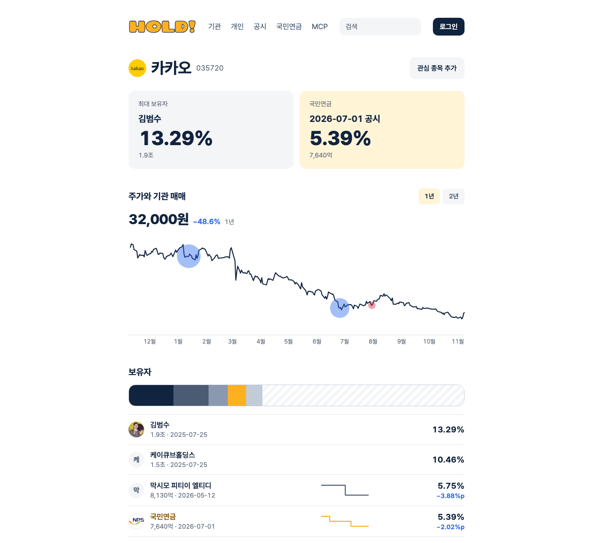

# HOLD! MCP — who owns Korean stocks

[한국어](README.ko.md)

Ask your AI who holds a Korean listed company, what the National Pension Service sold this week, or what price a controlling shareholder paid. HOLD! reads Korea's ownership filings (DART) and serves them as a remote MCP server.

```
https://whohold.com/mcp
```

No install, no API key. Paste the URL into any MCP client that speaks Streamable HTTP.



## Connect

**Claude.ai** — Settings → Connectors → Add custom connector. Name it `HOLD`, paste the URL, then turn it on in a new chat.

**Claude Code**

```bash
claude mcp add --transport http hold https://whohold.com/mcp
```

**Cursor** — Settings → MCP → Add server:

```json
{ "mcpServers": { "hold": { "url": "https://whohold.com/mcp" } } }
```

**VS Code** — `.vscode/mcp.json`:

```json
{ "servers": { "hold": { "type": "http", "url": "https://whohold.com/mcp" } } }
```

## Ask it

- Who owns more than 5% of Kakao, and how did NPS's stake change this year?
- Every stock NPS cut this week
- Korean stocks where BlackRock holds over 5%
- What did Pan Ocean's largest shareholder pay per share?
- Who indirectly owns Samsung Electronics through Samsung C&T and Samsung Life?

More in [examples/prompts.md](examples/prompts.md). You can ask in English. Holder names come back as filed, usually in Korean, and your AI can translate them.

## Tools

| Tool | What it returns |
|---|---|
| `search_symbol` | Listed company by name or ticker |
| `search_holder` | Holders by name. Typing 블랙록 finds the BlackRock entities. Same-name people and companies stay separate |
| `get_holders` | Holders of 5%+ and insiders of 1%+ for one stock, plus indirect holders through other listed companies |
| `get_holder_history` | Every ownership filing for a stock, with the actual trade date when the filing gives one |
| `get_portfolio` | Everything one holder owns (default: NPS), ranked by stake |
| `get_avg_cost` | Average purchase price, computed from the per-trade prices in the original filings |
| `get_recent_changes` | Ownership filings from the last N days, across all stocks or for one ticker |
| `get_filing` | One filing in detail: each trade's date, method, shares before and after, and price |

All tools are read-only.

## What makes the data usable

- **One holder, one ID.** People and companies are told apart by the birth date or business registration number in the original filing, not by name. Two people named 김철수 get two IDs.
- **Real trade dates.** A 5% change only has to be reported within five business days. When the filing lists the trade date, you get it next to the filing date.
- **Trades vs. paperwork.** Debt-for-equity swaps, capital reductions, pledges and new listings are flagged `non_trade`, so they don't count as buying or selling.
- **Prices from the filings.** Average cost comes from the acquisition prices written in each filing, adjusted for splits and mergers.
- **Every answer cites its source.** Each row carries `as_of` (filing date) and a link to the original on DART.

## Limits

- Covers 5%+ large-holding reports and 1%+ executive/major-shareholder reports from the last two years. Stakes below those lines, and total foreign ownership, aren't disclosed in these filings.
- NPS and many foreign institutions file a short form that legally omits prices, so `get_avg_cost` can't price them.
- Updated on weekday evenings (KST). Filings appear on DART first.
- Information, not investment advice.

## Feedback

Found a wrong number or a holder merged with someone else? [Open an issue](../../issues/new) with the ticker and holder name. Feature ideas are welcome too.

## Sources

Filings: Financial Supervisory Service DART OpenAPI. Website: [whohold.com](https://whohold.com).

This repository holds documentation only. The MIT license covers the docs and examples here; the whohold.com server code is not open source.
